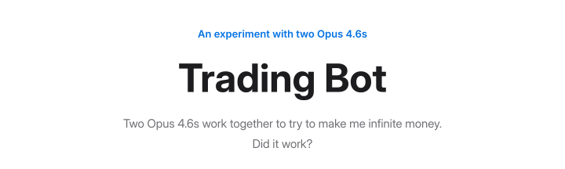
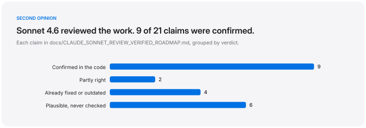
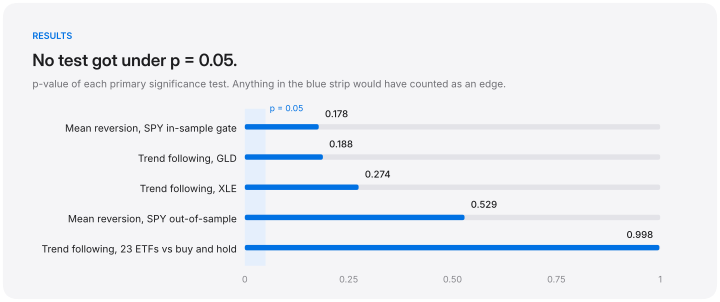
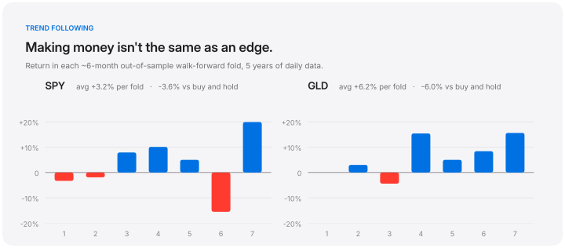
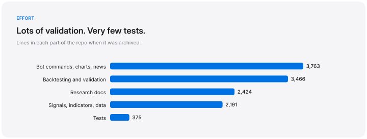
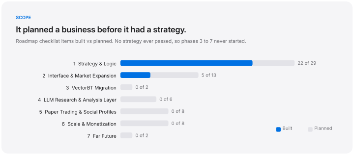

<p align="center">
  <picture>
    <source media="(prefers-color-scheme: dark)" srcset="docs/images/hero-dark.svg">
    
  </picture>
</p>

<p align="center">
  <picture>
    <source media="(prefers-color-scheme: dark)" srcset="docs/images/stats-dark.svg">
    
  </picture>
</p>

<br>

## The experiment

I wanted to see how far two copies of Claude Opus 4.6 could take a algorithmic trading project. It would research, pick a strategy, build it, and then work out whether the strategy actually made money. Working together, the two of them wrote most of the code, research notes and test design in this repo. Claude Sonnet 4.6 came in once as an outside reviewer.

The project started as a Discord bot that posted buy and sell signals, and that part worked fine. The interesting part came when Opus had to prove the signals had an edge.

They didn't. After five rounds of testing on two strategies and 23 ETFs, nothing beat buying and holding. The project was archived on March 26, 2026.

So this page isn't really about the bot. It's about how the model did.

<br>

## What Opus 4.6 got right

It built the testing tools a real quant would use. That meant walk-forward optimization, a stationary bootstrap on the stitched-together out-of-sample returns, deflated and probabilistic Sharpe ratios, and Benjamini–Hochberg correction across tickers. It also wrote pre-registration files and kept a hold-out ticker (DIA) for one final run.

It let its own strategies fail. When the numbers came back bad, they went into the repo as failures. The paper trading config even labels the one remaining idea honestly: *"This is a post-hoc hypothesis suggested by the data, not a pre-committed blind test."*

It didn't take the review on faith. Each of Sonnet's 21 claims was checked against the code before anything changed. Four had already been fixed or were out of date, and two were only partly right.

It moved fast. The first version on February 26 was about 2,000 lines. A month later the repo was over 12,000.

<br>

## What it got wrong

It got the runtime badly wrong. It estimated a validation batch at 15 to 25 minutes per ticker. Each ticker actually runs 1,500 full-history backtests plus the walk-forward search, which takes many hours to a few days. The docs now say the old estimate "was **wrong**."

It wrote the right test and never ran it. The stationary bootstrap existed in `walk_forward.py`, but the command-line tool imported it and never called it. Sonnet caught that.

It tested trend following with a test that's rigged against it. Bar permutation shuffles away autocorrelation, which is exactly what trend following trades on. A trend strategy can fail that test even when it works.

One of its statistics meant nothing. The probability of backtest overfitting was calculated on profit factor scores, but the formula assumes Sharpe ratios. It had to be switched off.

It wrote almost no tests at first. The 20 tests in `tests/` came after the review. That's 375 lines, next to 3,466 lines of validation code.

Bugs slipped through without errors. A timezone mismatch broke the VIX regime data. Weekly backtests produced zero folds because of a hardcoded 60-bar minimum.

It planned a business before it had a strategy. The roadmap has seven phases, including leaderboards, a strategy marketplace and a $4 a month Pro tier. No strategy ever passed a test.

<br>

<p align="center">
  <picture>
    <source media="(prefers-color-scheme: dark)" srcset="docs/images/sonnet_review-dark.svg">
    
  </picture>
</p>

<br>

## The results

<p align="center">
  <picture>
    <source media="(prefers-color-scheme: dark)" srcset="docs/images/pvalues-dark.svg">
    
  </picture>
</p>

**Mean reversion** combined RSI, MACD, Bollinger Bands, SuperTrend, Stochastic, Williams %R, EMA, VWAP, OBV and CMF into one weighted vote. It ran on SPY, QQQ and IWM over 10 years of daily bars. With 48 parameter combinations, the average out-of-sample fold returned −1.5%, −1.2% and −3.5%. Cutting the grid to 4 combinations brought SPY to −0.1%, with a bootstrap p of 0.529. There were about 340 effective independent observations and roughly 80% power, so this is a real negative, not just too little data.

**Trend following** used 55-day Donchian breakouts with ATR trailing stops on 23 ETFs across stocks, commodities, bonds, currencies and emerging markets. Its average Sharpe was 0.177 below buy and hold (t = −3.23). Only 6 of the 23 beat buy and hold, including oil (USO), emerging markets (EEM) and bonds (IEF). Narrowing to the 12 non-equity tickers after the fact was still negative (−0.058, t = −0.78).

<p align="center">
  <picture>
    <source media="(prefers-color-scheme: dark)" srcset="docs/images/tf_folds-dark.svg">
    
  </picture>
</p>

**Also tried.** A VIX regime filter (bull, bear, mixed) made no real difference to any result. Cross-sectional momentum was dropped before being built. MTUM, a $17B momentum ETF, returned slightly less than SPY over ten years (15.62% vs 15.83% a year) with more volatility, so a retail indicator version seemed unlikely to do better.

<br>

## Where the effort went

<p align="center">
  <picture>
    <source media="(prefers-color-scheme: dark)" srcset="docs/images/code_split-dark.svg">
    
  </picture>
</p>

<p align="center">
  <picture>
    <source media="(prefers-color-scheme: dark)" srcset="docs/images/roadmap-dark.svg">
    
  </picture>
</p>

<br>

## Look around

The signal pipeline goes `src/data.py` → `src/indicators.py` → `src/indicator_scores.py` → `src/signals.py`. Trend following lives in `src/signals_trend.py`.

The test bench is mostly `src/walk_forward.py` and `src/run_wfo.py`. The 23-ticker comparison is `scripts/pool_validation.py`, and the multiple-testing correction is `src/stats_utils.py`.

The research notes in `docs/` are worth reading as a record of the model's reasoning. Start with `STRATEGY_AND_EDGE.md`, `WALK_FORWARD_OPTIMIZATION_RESEARCH.md` and `CLAUDE_SONNET_REVIEW_VERIFIED_ROADMAP.md`. `Roadmap` shows the full plan and where it stopped.

<br>

## Run it

```bash
pip install -r requirements.txt
python -m pytest tests/ -v

# one ticker, walk-forward + bootstrap
python -m src.run_wfo SPY --strategy mr --period 5y

# trend following vs buy and hold on 23 ETFs
python scripts/pool_validation.py --strategy tf --expanded --period 10y

# rebuild the charts on this page
python scripts/make_readme_charts.py
```

The full batch in `run_wfo_batch.ps1` takes days, not minutes. `main.py` starts the original bot and needs a token in `.env` (see `.env.example`).

<br>

<p align="center">
  <sub>For learning only, not financial advice. MIT licensed.</sub>
</p>
